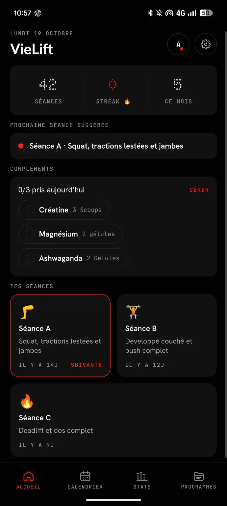
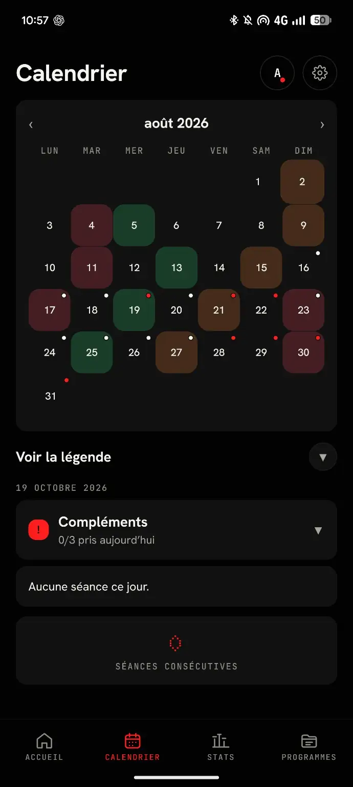
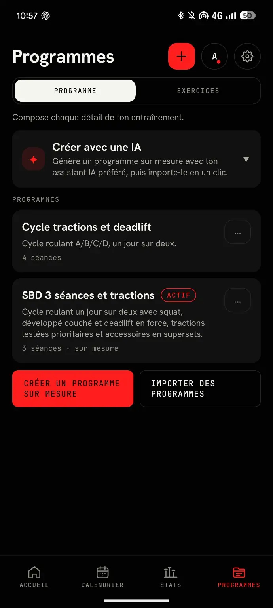
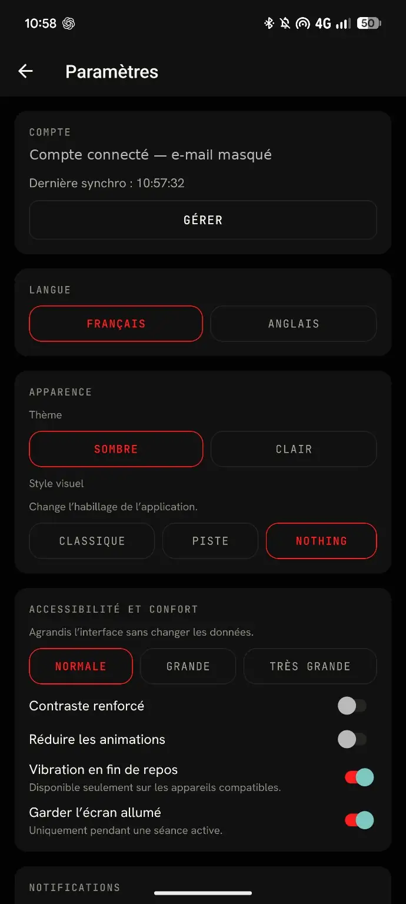

# VieLift

**Application Android de suivi de musculation**

*Projet personnel · Développement en cours*

## Aperçu de l'application

Ces visuels sont de **véritables captures d'écran de VieLift**, et non des maquettes générées. L'adresse e-mail du compte a été masquée sur la capture des paramètres.

<table>
  <tr><td align="center"><strong>Accueil</strong></td><td align="center"><strong>Calendrier</strong></td></tr>
  <tr>
    <td align="center"></td>
    <td align="center"></td>
  </tr>
  <tr><td align="center"><strong>Programmes</strong></td><td align="center"><strong>Paramètres</strong></td></tr>
  <tr>
    <td align="center"></td>
    <td align="center"></td>
  </tr>
</table>

## Présentation

**VieLift** est une application Android de suivi de musculation conçue pour organiser ses programmes, retrouver ses séances et suivre ses habitudes d'entraînement. L'interface est développée autour d'un principe simple : donner accès aux informations utiles sans complexifier la séance.

### Fonctionnalités présentées

- **Accueil :** récapitulatif des séances, suggestion d'entraînement, suivi des habitudes et compléments.
- **Calendrier :** visualisation des journées et historique d'entraînement.
- **Programmes :** création, organisation et import de programmes personnalisés, avec un parcours d'import de programmes générés avec une IA.
- **Personnalisation :** choix de la langue, du thème, du style visuel et des options d'accessibilité.

## Développement

VieLift est un **projet personnel en cours de développement**. Je conçois et fais évoluer l'application en utilisant des outils d'IA pour accélérer le prototypage et l'implémentation, tout en effectuant les vérifications et les tests nécessaires.

## Code source

Le code source est conservé dans un **dépôt privé**. Ce dépôt public présente le projet et son interface pour mon portfolio, sans publier l'implémentation interne.

---

Développé par **[Aristide Vella](https://github.com/aristidew1)**.
